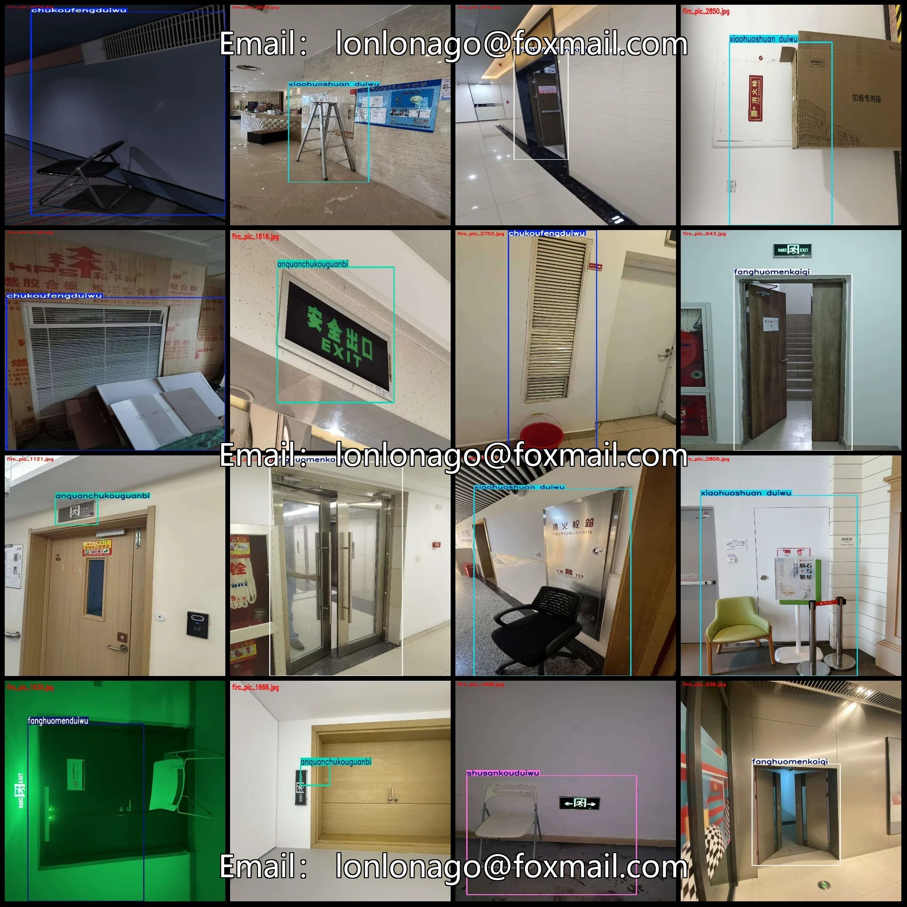
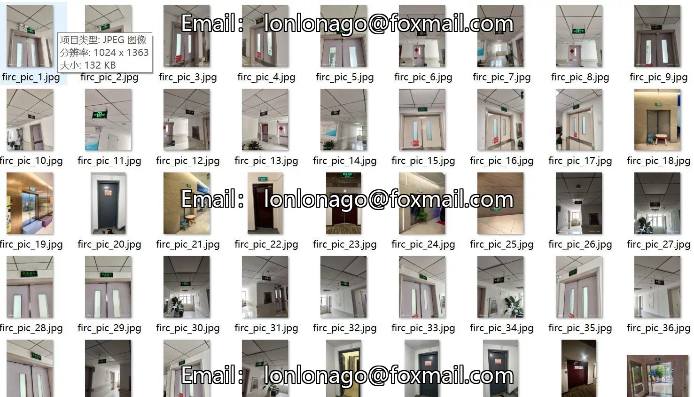
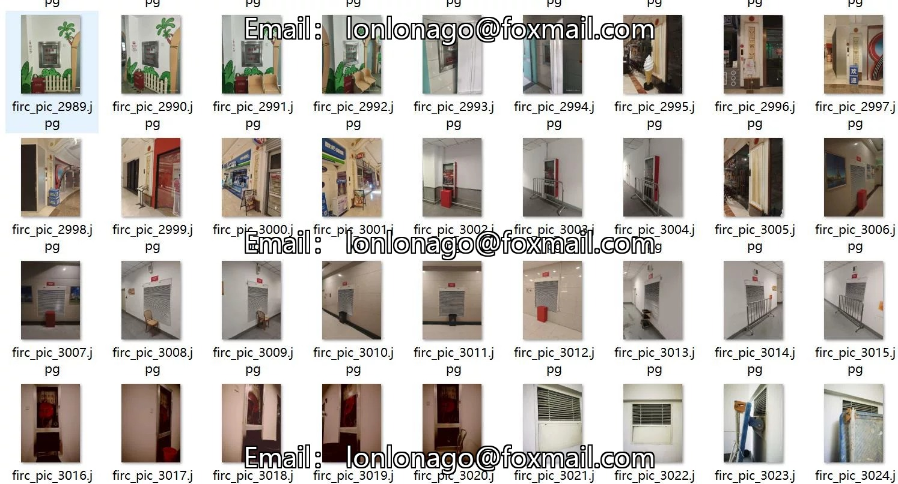
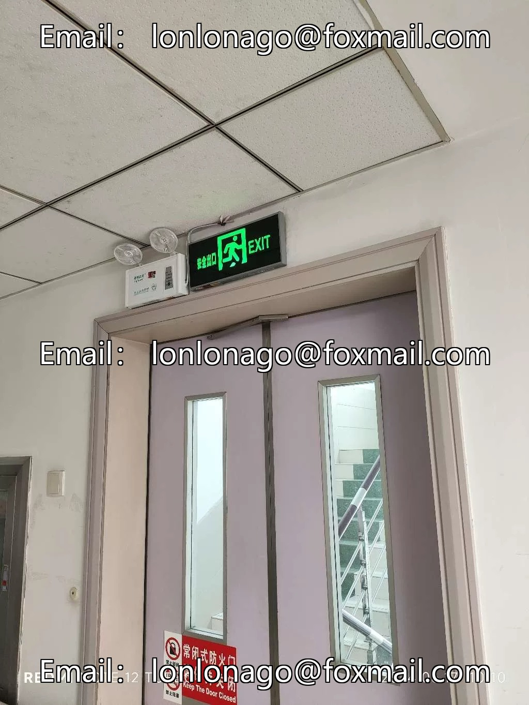

# Fire Safety Compliance Fire Safety Regulations Dataset in VOC+YOLO format with 2310 images

## Body

Fire Safety Compliance Fire Safety Regulations Dataset - VOC+YOLO Format - 2310 Images in 7 Categories
Warm Reminder: Due to the dataset's replicability, please confirm compliance with requirements before purchasing.
Dataset Format: Pascal VOC format + YOLO format (txt files without split paths, only containing jpg images and corresponding VOC format xml files and yolo format txt files)
Number of Images (Total jpg files): 2310
Number of Annotations (Total xml files): 2310
Number of Annotations (Total txt files): 2310
Number of Annotation Categories: 7

Label category names (Note that the order of categories in the YOLO format does not correspond to this, but is based on the labels folder's classes.txt): ["anquanchukouguanbi", "chukoufengduiwu", "fanghuomenduiwu", "fanghuomenkaiqi", "shusankouduiwu", "shusankouguanbi", "xiaohuoshuan duiwu"]

1. Safety Exit Closure
2. Air Conditioner Outlet Obstruction
3. Fire Door Obstruction
4. Fire Door Opening
5. Egress Outlet Obstruction
6. Egress Outlet Closure
7. Water Sprinkler Obstruction

Shusankouduiwu: Frames = 162, Image Count = 162
Shusankouguanbi: Frames = 264, Image Count = 264
Xiaohuoshuan duiwu: Frames = 579, Image Count = 579
Total Frames: 2380
Image Resolution: Multi-resolution such as 1024x1365 etc.
Labeling Tool: labelImg
Labeling Rules: Draw a rectangle around the category.
Important Note: The dataset does not have separate training, validation, and test sets; you need to partition them yourself.
Special Remark: This dataset does not guarantee the accuracy of the trained models or weight files.

## Images

## Payment

Here is a pay link on Stripe ( https://buy.stripe.com/3cs8yP7sY87d0vu9AB ). Please contact me lonlonago@foxmail.com after funding $89, and I will send you a complete data files , thank you!

